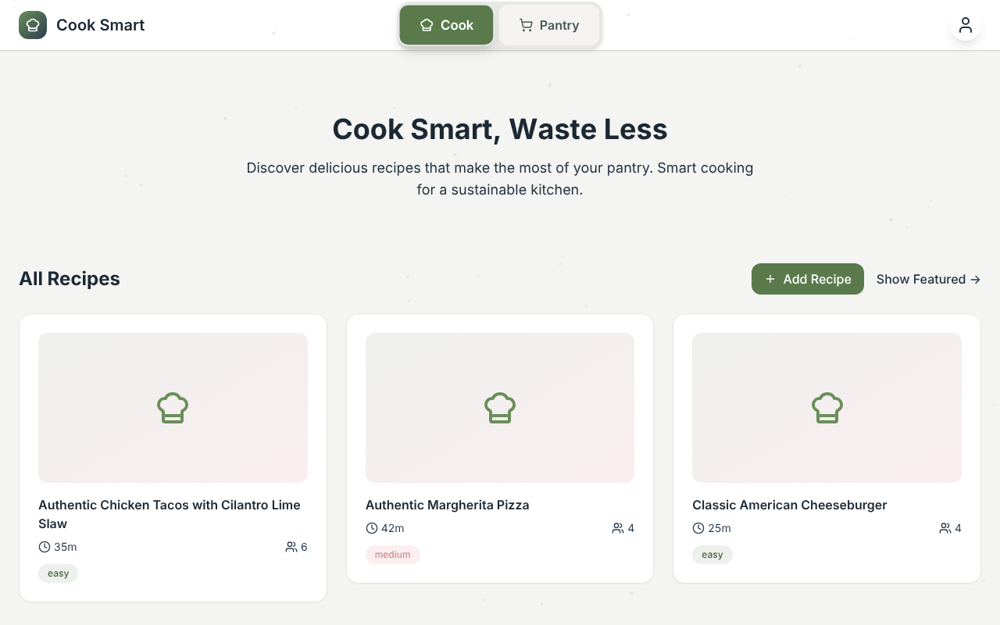
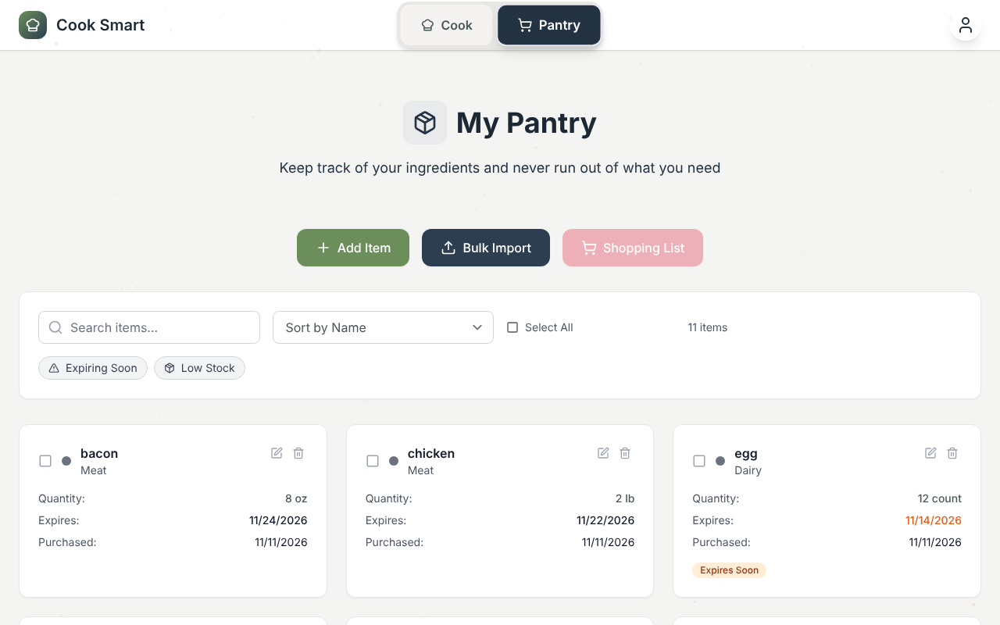

# Cook Smart

**Track what's in your pantry and see which recipes you can make with it.**

Cook Smart is a full-stack web app for cooking with what you already have. Add your ingredients, and it ranks recipes by how much of each one you can make right now. Items close to expiring get flagged so they're used first.




## What it does

- **Pantry tracking:** quantities, units, categories, and expiration dates, with "expiring soon" and "low stock" filters and bulk import.
- **Recipe matching:** scores every recipe against your pantry and shows what's missing.
- **Ingredient normalization:** maps messy names to canonical ingredients ("cherry tomatoes" → tomato, "spaghetti" → pasta) so matching actually works.
- **Unit conversion:** compares "2 lb" in the pantry against "500 g" in a recipe.
- **Recipe import:** pulls from TheMealDB, Spoonacular, or local JSON files, with a quality score that filters out incomplete recipes.

## Tech stack

| Layer | Tools |
|---|---|
| Frontend | React, TypeScript, Tailwind CSS, React Router |
| Backend | Node.js, Express, REST API |
| Data | SQLite |
| Security | Helmet, CORS allow-list, rate limiting |

## How it works

```
React client ──REST──▶ Express API ──▶ SQLite
                          │
                          ├─ ingredientNormalizer   canonical ingredient names
                          ├─ unitConverter          weight/volume/count conversions
                          ├─ recommendations        pantry-coverage scoring
                          └─ importers              TheMealDB / Spoonacular / JSON
```

More detail is in [DESIGN.md](DESIGN.md) (schema, API design, and the matching algorithm).

## Run it locally

Requires Node 18 or later.

```bash
npm run install-all   # installs root, server, and client dependencies
npm run dev           # API on :5001, client on :3000
```

On first start the server creates the database and loads the sample recipes in `server/recipes/`. To pull more from TheMealDB:

```bash
cd server && node scripts/importRecipes.js --source themealdb --limit 20
```

## Deploy

The server serves the built client in production, so it deploys as a single Node service (Render, Railway, Fly.io):

- **Build command:** `npm run build`
- **Start command:** `npm start`
- **Optional env:** `DATABASE_PATH` (point at a persistent disk), `CLIENT_ORIGIN` (only if the client is hosted separately), `SPOONACULAR_API_KEY`

## API

| Method | Route | Purpose |
|---|---|---|
| GET/POST | `/api/pantry/items` | List or add pantry items |
| PUT/DELETE | `/api/pantry/items/:id` | Update or remove an item |
| GET | `/api/recipes` | Search recipes |
| GET | `/api/recommendations/recipes` | Recipes ranked by pantry coverage |
| GET | `/api/pantry/items/expiring` | Items expiring soon |
| POST | `/api/pantry/shopping-list` | Build a shopping list |
| POST | `/api/import/mealdb/random` | Import recipes from TheMealDB |
| GET | `/api/health` | Health check |

## License

MIT
